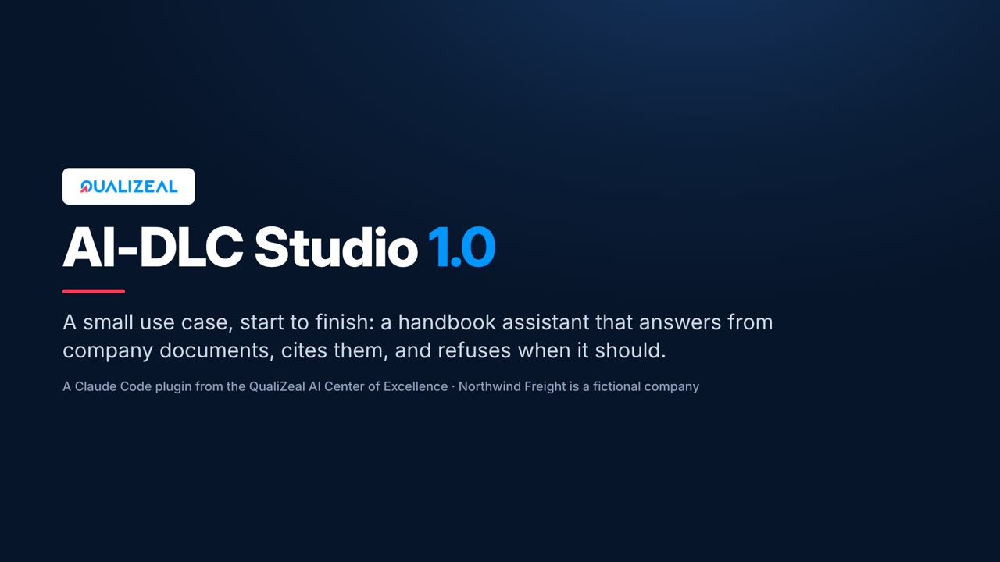

# QualiZeal AI-DLC Studio · 1.0.0

How the QualiZeal AI Center of Excellence (AI CoE) builds with Claude Code, in one install. An AI full-stack developer
or a generative AI (GenAI) engineer gets tested starters for the stacks our projects use, lanes that carry a piece of
work from a decision to a reviewed pull request, and a harness that keeps prompts, keys and pricing where they belong.
AI-DLC is the AI-Driven Development Life Cycle.

Prepared by Prashobh Paul, AI Architect, QualiZeal AI CoE. Internal to QualiZeal.

| Plugin | What it is |
|---|---|
| `qz-aidlc` | Lanes, starters and tools, and the harness around them: a policy guard on every tool call, an audit chain, a run ledger and report cards |
| `qz-console` | A live map of the harness at work, in a pane beside the conversation (Claude Code only) |

## Start here

About 15 minutes, no administrator rights. The repository is private, so accept the invitation to the
`qualizeal-aicoe` organisation on GitHub first.

Windows, in PowerShell:

```powershell
winget install --id Git.Git -e        # only if Git is missing; then open a new terminal
git clone https://github.com/qualizeal-aicoe/Qualizeal_AIDLC_For_InHouse.git
cd Qualizeal_AIDLC_For_InHouse
setup\bootstrap.cmd
```

macOS or Linux:

```sh
git clone https://github.com/qualizeal-aicoe/Qualizeal_AIDLC_For_InHouse.git    # macOS without Git: xcode-select --install
cd Qualizeal_AIDLC_For_InHouse
sh setup/bootstrap.sh
```

The first clone opens a browser to sign in to GitHub. The bootstrap installs what is missing into your user folder
(Claude Code, uv, and Python 3.12 when no Python 3.11 to 3.13 is found), adds the Studio to Claude Code and runs the
doctor. Its last line should read `Result: ready for a live session`. A line marked FAIL says how to fix it: fix it
and run the bootstrap again, which is safe to repeat. The doctor writes `doctor-report.json` beside the bootstrap;
send that file to the AI CoE when something will not pass. `-CheckOnly` on Windows, `--check-only` elsewhere, checks
without installing anything.

Then restart Claude Code, sign in with the Claude account you use for work, type `/qz-aidlc:qz-setup` once, and from
then on `/qz-aidlc:qz` followed by what you want to do. `/qz-aidlc:qz-help` lists every command; the same page is
[docs/QUICK-GUIDE.md](docs/QUICK-GUIDE.md).

Other ways in (an organisation that turns the Studio on for everyone, the Claude app, many laptops at once,
continuous integration (CI)): [docs/SETUP-GUIDE.md](docs/SETUP-GUIDE.md).

## Starters

`/qz-aidlc:qz-build <starter>` in Claude Code, or say what you want in plain words. Each starter is a small project
that runs on the first day and already has the parts teams tend to skip: a person approves anything with side effects,
limits sit in one policy file, every step is traced, an offline stub model lets the tests run with no key, a gold set
of evaluation cases gates each change, and CI and a runbook come with it.

| Starter | What it is | Checked in CI on every push |
|---|---|---|
| `langgraph` | LangGraph with LangChain (Python) | 4 tests and 10 gold cases, with interrupt and resume; Windows and Linux |
| `openai-agents-py` | OpenAI Agents SDK (Python) | 6 tests and 10 gold cases, with an approval, a declined refund and a resume from saved state; Windows and Linux |
| `claude-agent-sdk-py` | Claude Agent SDK (Python) | 4 tests and 10 gold cases; Windows and Linux |
| `claude-agent-sdk-ts` | Claude Agent SDK (TypeScript), traced with OpenTelemetry | type check, 4 tests and 10 gold cases; Linux |
| `mcp-server-py` | A read-only MCP (Model Context Protocol) server in Python, for other agents to call | 6 tests and 8 contract cases through a real MCP client; Windows and Linux |
| `advanced-rag` | Hybrid RAG (retrieval-augmented generation): keyword search and vectors, fused and then reranked, all on the CPU | 54 tests; 38 of 40 golden questions with the real models, against 35 for keyword search alone; no safety violations; Windows and Linux |
| `vectorless-rag` | RAG with no vector database: a tree of headings and SQLite full-text search, built live one stage per story | 50 tests; 35 of 40 golden questions with keyword search, 39 with synonyms, 40 with outline navigation added (offline stub); Windows and Linux |
| `strands-agentcore` | AWS Strands on Bedrock AgentCore, with Kiro steering and specs | 5 tests and 10 gold cases; Linux |
| `maf-dotnet` | Microsoft Agent Framework (.NET 10) | build, 4 tests and 10 gold cases; Linux |
| `go-anthropic` | Go on the Anthropic API | vet, tests and 10 gold cases; Linux |

The Python starters use uv with a lock file, so a laptop gets the versions CI tested (the Strands starter keeps a
requirements file). Only the TypeScript starter needs
Node.js (22); `maf-dotnet` needs the .NET 10 SDK and `go-anthropic` Go 1.26. Every gold set runs against the offline
stub, so none of these numbers involves a live model.

## Lanes

| Lane | Start it with | What you get |
|---|---|---|
| Project | `/qz-aidlc:qz-project` | A home for the work on your own computer: one folder per project with `code`, `docs`, `ppts`, `guides` and `architecture`, every result filed as it is produced, and an index page that links it all |
| Architect | `/qz-aidlc:qz-architect` | Testable requirements; options scored against a no-agent baseline on locked criteria; spikes with criteria fixed in advance; diagrams at enterprise, system and workflow level; an independent review; a gate before anything is called final. Motion diagrams from one reviewed spec: a page that plays, a looping GIF, an MP4 and an animated PowerPoint |
| Spec | `/qz-aidlc:qz-spec` | A design document drafted section by section in `docs/designs/`, reviewed in stages by reviewers that see only the document and the files it links, never the conversation; findings merged; the author's resolution checked; your approval; then writes held to the spec's file boundary |
| Build | `/qz-aidlc:qz-build` | A project from one of the starters above, with its approval gate, limits, tracing, offline stub, gold set, CI and runbook |
| RAG | `/qz-aidlc:qz-rag` | A knowledge assistant over documents from a tested kit, vectorless or hybrid: cited answers or a refusal, access control inside the search query, planted instructions quarantined, 40 golden questions and a gate. The vectorless kit is built live one stage per story; the hybrid kit keeps a trace of every answer and packs its index into portable knowledge cores |
| Eval | `/qz-aidlc:qz-eval` | Gold set runner with record and replay, pass rate with a 95% interval, regression gate, model judge calibrated against people |
| Test | `/qz-aidlc:qz-test` | Test cases designed from a story with named techniques, coverage check, traceability, export to Xray, Gherkin or Playwright after approval. UI scenarios that leave a screenshot per step, a captioned video and an evidence page; a packaged suite to hand over |
| Design | `/qz-aidlc:qz-design` | A direction agreed before any styling; the rendered page measured at four widths for contrast, type, focus, touch targets, overflow and motion; an independent critique; named fix passes |
| Deck | `/qz-aidlc:qz-deck` | Audience, decision and minutes first; titles that make the argument when read in order; story and slide-build checks; a rehearsal against the most sceptical person in the room |
| Audit | `/qz-aidlc:qz-audit` | Readiness score for an agentic repository across six pillars, mapped to the OWASP (Open Worldwide Application Security Project) Top 10 lists for large language model (LLM) and agentic applications |
| Deliver | `/qz-aidlc:qz-deliver` | A Jira story to a reviewed pull request through AWS AI-DLC stages, with the story, design, test evidence, code-impact report and pull request text kept in the project folder |
| Demo | `/qz-aidlc:qz-demo` | Prospect demos and recorded walkthroughs from starters |
| Bid | `/qz-aidlc:qz-bid` | Proposal decks, RFP (request for proposal) answers, SOW (statement of work) and pricing from the SEG workbook. Rates, cost and margin never reach the client view |
| Knowledge | `/qz-aidlc:qz-kf` | Trust-scored, cited answers from Confluence, GitHub and files; client-facing work reads only documents cleared for clients; golden questions catch a drop in search quality |
| Office | `/qz-aidlc:qz-office` | Five decks, planning and status workbooks, estimates within 13 weeks and 6 people, and status mail, minutes and reports shaped for each reader, from a lead to a CEO or a client |
| Publish | `/qz-aidlc:qz-publish` | The work on GitHub after the local copy is saved: a new private repository, an existing one or the team's, through a branch and a pull request a person merges |

`/qz-aidlc:qz` picks the lane from what you ask.

## A live session

[docs/LIVE-SESSION.md](docs/LIVE-SESSION.md) is the plan for an instructed session: what everyone does five days and
one day before, the 75 minutes, and the fallback when a laptop will not cooperate. The use case is deliberately
small: a knowledge assistant over a fictional company's handbook, built with the hybrid kit. It answers from the
documents with the section it used, and refuses when the handbook does not say or the person asking may not read it.

[](docs/media/handbook-demo.mp4)

The video (57 seconds, no sound) is made from real output of the commands in the plan; nothing in it was mocked.

## How it keeps prompts, keys and pricing safe

- Every tool call passes a policy guard (deny, ask, allow), and the guard reads every command on a shell line, not
  only the first. Writes to Jira, Confluence and GitHub wait for a person. Agents never merge.
- Content from tickets, pages, files and tools is data. Text that addresses the model is flagged: documents that carry
  it are quarantined from the Knowledge Fabric, and both RAG kits quarantine such sentences when they read a document.
- The RAG kits apply access control inside the search query, before anything is ranked, and never answer without a
  citation. The MCP starter marks every result as untrusted data and pins its tool descriptions, so a changed
  description fails the tests.
- Credentials are blocked from files and commands (cloud, source control, Atlassian and model-provider key formats),
  redacted from evaluation recordings, and any evaluation case whose output contains one fails. Tokens the plugin
  needs are marked sensitive, so Claude Code keeps them with its own credentials (the system keychain where there is
  one), not in a settings file.
- The Studio's own tools call no model. Model traffic stays on the hosts your Claude plan already uses; a starter calls
  a model only when you give it a key. The hybrid kit downloads two small open models once (about 150 MB) and runs them
  on your CPU, so documents never leave the laptop.
- Pricing cost, pay rates and margin stay in `.qz/internal/`. Client documents are checked for them before they leave,
  and nothing enters a project's memory without a person approving the exact words.
- The browser checks open local files by default; another host is used only after a person lists it, internal and
  cloud-metadata addresses are refused, and steps that delete, pay or send are refused outside a test environment.
- Each release ships a list of its files' hashes. A skill, hook or policy file edited after release is named at the
  next session start, and the doctor shows it.

## What was run, and what was not

Run on 20 November 2026:
- **CI on every push** to the release branch, on Windows (Python 3.12) and Linux (Python 3.11 and 3.13): the Studio's
  276 tests (274 passed and 2 skipped on Linux, the two that need the internal pricing workbook; 273 passed and 3
  skipped on Windows); the guard's red-team, 137 of 137; the doctor and the bootstrap started the way an attendee starts
  them; the handbook demo rehearsed stage by stage; and Claude Code's own plugin check on the marketplace and both
  plugins, with Claude Code from its native installer. The numbers are from Actions run 44736566026; every push runs
  the same checks, and the Actions tab shows the latest.
- **Every starter**, created from the packed kit and tested as the table above says, Windows and Linux for the Python
  ones. The hybrid kit with its real models on a CPU with no GPU scored 38 of 40 on both systems, with no safety
  violations.
- **Installing from this repository**: the marketplace added from GitHub (the release branch, before it was merged)
  and both plugins installed at 1.0.0 by Claude Code 2.1.329, in a clean configuration.
- **The handbook demo end to end**, which is where the video comes from, and its offline fallback, which answers 35 of
  40 and is described in the session plan.

Not run:
- **An attendee's own laptop.** The first bootstrap on a QualiZeal machine is the real test; the doctor's report says
  what is missing. The likely surprises are a company proxy or a network that re-signs HTTPS, and the doctor checks
  for both.
- **macOS in CI.** It runs on a release tag, or by hand from the Actions tab.
- **A live model.** No starter, kit or agent here called one: the gold sets run against offline stubs, and the demo's
  answers are sentences taken from the documents, so the session needs no API key. A starter's first call with a real
  key is the first time that path runs.
- **A person working in a live Claude Code session with the hooks.** The hooks were started exactly as Claude Code
  starts them, with the input it sends, but no interactive session was recorded.
- The GitHub agent on GitHub; the status line on a Pro, Max or Ultra sign-in; organisation sync from this repository.
- Cursor and Codex. 1.0.0 is for Claude Code; they are planned for 1.1.

## Where things are

| | |
|---|---|
| [CHANGELOG.md](CHANGELOG.md) | What changed in 1.0.0 |
| [docs/SETUP-GUIDE.md](docs/SETUP-GUIDE.md) | Every way to install: one person, many laptops, a whole organisation |
| [docs/LIVE-SESSION.md](docs/LIVE-SESSION.md) | Running an instructed session |
| [docs/QUICK-GUIDE.md](docs/QUICK-GUIDE.md) | Every command, the QualiZeal names, and how to spend fewer tokens |
| [docs/DEMO-VECTORLESS-RAG.md](docs/DEMO-VECTORLESS-RAG.md) | A longer session that builds the vectorless kit live, one story at a time |
| [docs/GITHUB-AGENT.md](docs/GITHUB-AGENT.md) | The GitHub agent, set up from the website |
| [docs/HISTORY.md](docs/HISTORY.md) | Releases 0.4.0 to 0.10.0, as described at the time |
| [LAYERS.md](LAYERS.md) | What is AWS AI-DLC and what is ours |
| [CREDITS.md](CREDITS.md) | The projects that shaped the Studio, and their licences |
