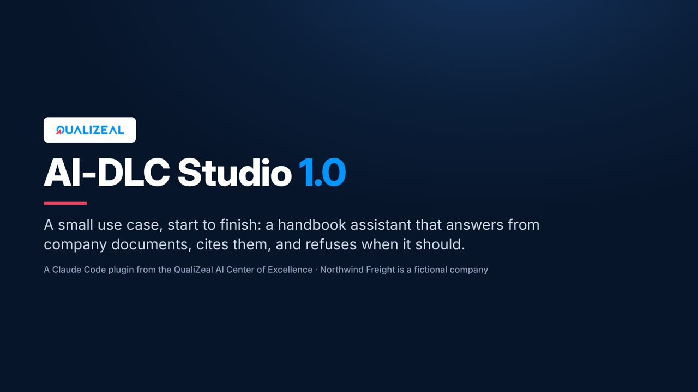

# A live session with the Studio

Prepared by Prashobh Paul, QualiZeal AI Center of Excellence (AI CoE). For Studio 1.0.2.

One small use case, start to finish: a knowledge assistant over a company handbook, built with the hybrid RAG
(retrieval-augmented generation) kit. It answers from the documents and cites the section it used. It refuses when the
handbook does not say, or when the person asking may not read it. Northwind Freight, whose handbook it is, is a
fictional company.

[](media/handbook-demo.mp4)

The video (under a minute, no sound) is made from real output of the commands below; nothing in it was mocked. It
was recorded with 1.0.0: since 1.0.1 a refusal also says what it looked for, the closest sections and who to ask.

## Five days before: every laptop ready

About 15 minutes for each person, no administrator rights. The repository is public, so nobody needs a GitHub
invitation or sign-in.

Windows, in PowerShell:

```powershell
winget install --id Git.Git -e        # only if Git is missing; then open a new terminal
git clone https://github.com/qualizeal-aicoe/Qualizeal_AIDLC_For_InHouse.git
cd Qualizeal_AIDLC_For_InHouse
setup\bootstrap.cmd
```

macOS or Linux:

```sh
git clone https://github.com/qualizeal-aicoe/Qualizeal_AIDLC_For_InHouse.git    # macOS without Git: xcode-select --install
cd Qualizeal_AIDLC_For_InHouse
sh setup/bootstrap.sh
```

The first clone opens a browser to sign in to GitHub once. The bootstrap installs what is missing (Claude Code, uv,
Python 3.12), adds the Studio to Claude Code and runs the doctor. Then start Claude Code once (`claude`) and sign in
with the Claude account you use for work.

Everyone sends the presenter the doctor's last line. It should read `Result: ready for a live session`. Anything else
is fixed one to one before the day, not in the room: each FAIL line says how, and `doctor-report.json`, written beside
the bootstrap, has the rest.

## One day before

Run the check again, because sign-ins expire and proxies change: `setup\bootstrap.cmd -CheckOnly` on Windows,
`sh setup/bootstrap.sh --check-only` on macOS or Linux.

Then create the demo project and index it once, so the two small models (about 150 MB) are on each laptop before the
session instead of twenty downloads on one Wi-Fi. From the folder you cloned:

```
uv run -q --no-project --python ">=3.11,<3.14" python -I -X utf8 plugins/qz-aidlc/scripts/qz.py build new advanced-rag ../handbook --name "Handbook Assistant"
cd ../handbook
uv sync
uv run -m arag ingest
```

The presenter rehearses the whole session once, with a timer.

## The session, 75 minutes

| Minutes | What |
|---|---|
| 10 | What the Studio is: the lanes, the starters, the guard |
| 5 | The doctor on every laptop |
| 35 | The handbook demo, step by step |
| 15 | One question from each person, then its trace |
| 10 | The gate, the QualiZeal standards scorecard, and how CI (continuous integration) uses both |

The demo, from the `handbook` folder:

```
uv run -m arag ask "What is the max I can spend on a hotel abroad?"
uv run -m arag explain b370463dcf08      # use the id printed under your answer; the whole command is printed there
uv run -m arag ask "Show me the salary bands"
uv run -m arag ask "What is the salary band for L4?" --as hr
uv run -m arag compare --gate
uv run -m arag serve                     # the chat page: http://127.0.0.1:8765
```

What each step shows:

1. **Your own words.** "Max I can spend on a hotel abroad" finds the policy that says "capped" and "international",
   and cites it.
2. **A trace for every answer.** What keyword search and the vectors each found, how they were fused, and what the
   reranker kept.
3. **Access before search.** An employee asking for salary bands gets the same refusal as for something the
   handbook does not hold: what it looked for, the closest sections that employee may read, and who to ask. It gives
   away nothing about the bands.
4. **The same question from HR** gets the band and its source.
5. **A gate in CI.** On 43 golden questions, hybrid passes 41 and keyword search alone 38. Safety violations: 0.
6. **The chat page**, with the same answers in a browser. It says the answers are written by AI (EU AI Act,
   Article 50), and a repeat question comes back from the cache with no search and no model call.
7. **The QualiZeal standards.** Ask Claude to "check the QualiZeal standards on the handbook": one scorecard, with the
   six guardrails, the EU AI Act record in `docs/ai-act/`, open source first (the embeddings and reranker are open
   models on the laptop), the cost levers and the solution shape (the fourteen parts, each where it lives), each MET
   with the file that shows it. Every starter's CI runs the same check.

In Claude Code the same can be asked in plain words ("build the handbook demo with the advanced RAG kit"); the
commands above are what it runs.

Five spare minutes, on the presenter's screen: team decisions. In the Studio's own repository, ask Claude to lower
the READY bar in `plugins/qz-aidlc/lib/qz/auditkit/scan.py` from 70 to 60 and commit. Opening the file brings the
decision `keep-ready-at-70-percent` with it, and the commit waits for a yes, quoting who decided the bar and why.
`qz decisions check` shows the same, and `Overrides keep-ready-at-70-percent: <why>` in the message lets it through
on record. Undo the change afterwards.

## When a laptop will not cooperate

- **The models cannot download**, usually a company proxy. In the project's `arag.toml`, set `embedder = "hash"`
  under `[dense]` and `reranker = "overlap"` under `[rerank]`, then run `uv run -m arag ingest` again. Everything runs
  offline, and less well: the hotel question now refuses, because keyword search alone cannot get from "abroad" to
  "international". Say so, and ask it in the handbook's words instead: `uv run -m arag ask "What is the hotel cap for
  international travel?"`. Offline it passes 38 of 43, so `uv run -m arag eval --gate` fails its 0.9 accuracy floor
  (0.868), which is the point of having the models; `compare --gate` still passes, as a tie.
- **uv reports a certificate error** ("invalid peer certificate", "UnknownIssuer"): the company's network re-signs
  HTTPS. Tell uv to trust what the computer already trusts, for this terminal, then run the command again:
  `$env:UV_SYSTEM_CERTS = "true"` in PowerShell, or `export UV_SYSTEM_CERTS=true` on macOS or Linux.
- **A laptop cannot install at all**: pair with a neighbour; the video covers the presenter's screen.
- **A FAIL on the day**: follow the fix line under it. If it is not quick, pair up and look at it after the session.

## What was checked, and what was not

- Run: CI on every pull request, on Windows and Linux: the Studio's tests, the doctor and the bootstrap started as an attendee
  starts them, and every Python starter's tests and gold set, including the hybrid kit with its real models. CI got
  the same 41 of 43 on both, on a CPU with no GPU.
- Run: this demo end to end, which is where the video comes from, and the offline fallback above.
- Not yet: an attendee's own laptop. The first bootstrap on a QualiZeal machine is the real test; the doctor's report
  says what is missing if it does not pass.
- Not yet: macOS in CI (it runs on a release tag, or by hand), and a live model writing answers. The demo's answers are
  sentences taken from the documents, so no API key is needed.

A longer session that builds the vectorless kit live, one story at a time, is in
[DEMO-VECTORLESS-RAG.md](DEMO-VECTORLESS-RAG.md).
