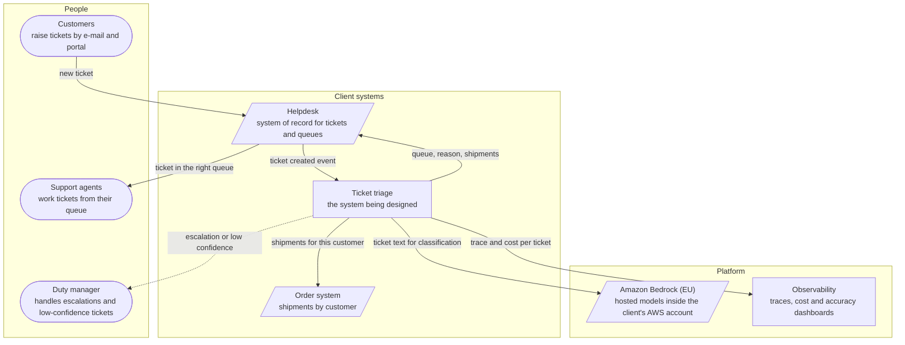
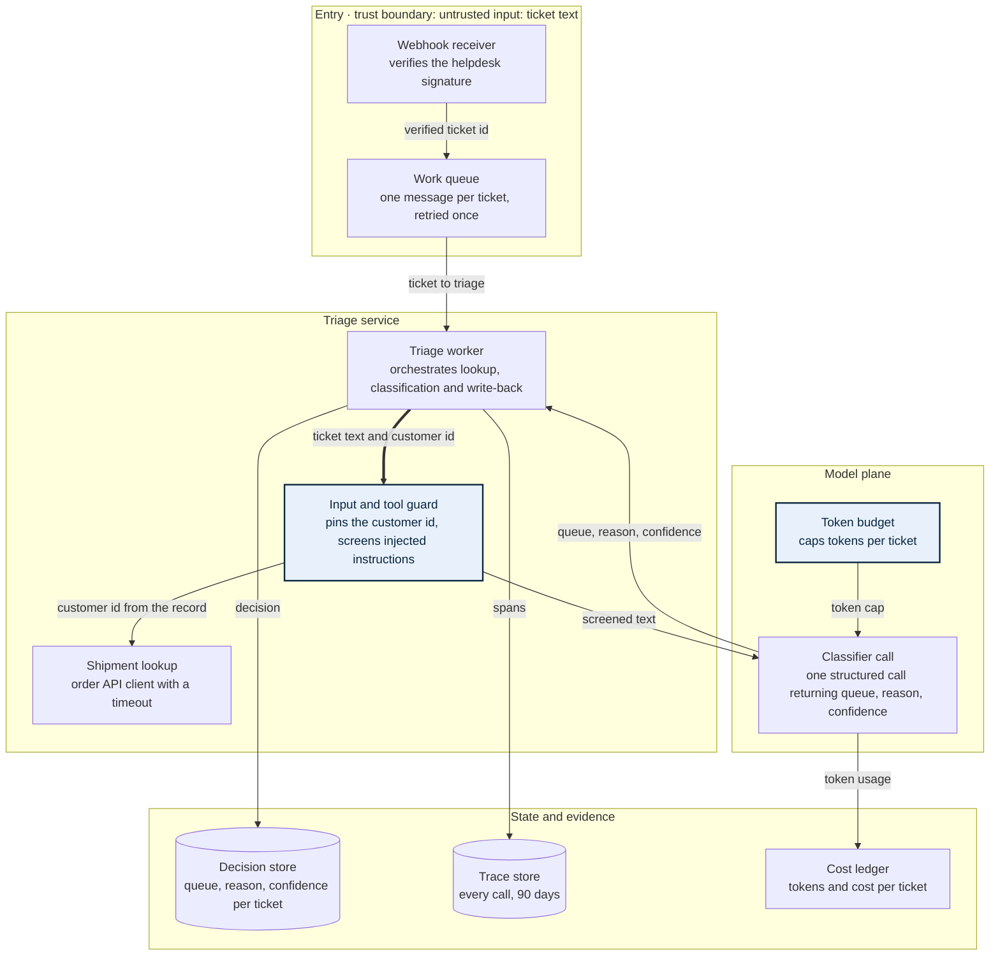
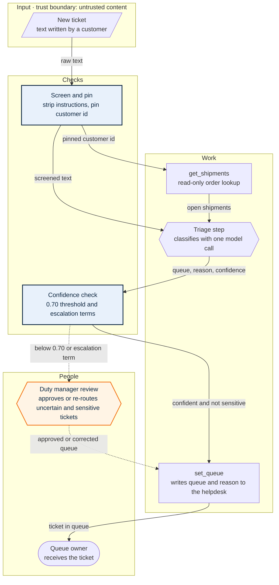

# Support ticket triage

A fixed workflow with one model call classifies each new ticket, attaches the customer's shipments and sends anything uncertain or sensitive to a person.

## Enterprise view

Where the system sits: the people, the business systems around it and who owns what.

| Box | What it does | Kind |
|---|---|---|
| Customers | raise tickets by e-mail and portal | person |
| Support agents | work tickets from their queue | team |
| Duty manager | handles escalations and low-confidence tickets | person |
| Helpdesk | system of record for tickets and queues | external |
| Ticket triage | the system being designed | system |
| Order system | shipments by customer | external |
| Amazon Bedrock (EU) | hosted models inside the client's AWS account | external |
| Observability | traces, cost and accuracy dashboards | observability |

How it flows:

1. **A ticket arrives.** The customer raises a ticket; the helpdesk tells triage a new one exists.
2. **Triage gathers and decides.** Triage reads the customer's shipments and asks the model for a queue and a reason.
3. **The ticket lands.** Queue, reason and shipments are written back, and the ticket shows up in the right team's queue.
4. **People keep the hard ones.** Escalations and low-confidence tickets go to the duty manager, and every decision leaves a trace.

Animated: `arch/diagrams/enterprise/index.html`

## System view

What is inside: services, agents, stores, the model plane and the controls between them.

| Box | What it does | Kind |
|---|---|---|
| Webhook receiver | verifies the helpdesk signature | service |
| Work queue | one message per ticket, retried once | queue |
| Triage worker | orchestrates lookup, classification and write-back | service |
| Input and tool guard | pins the customer id, screens injected instructions | guard |
| Shipment lookup | order API client with a timeout | tool |
| Classifier call | one structured call returning queue, reason, confidence | model |
| Token budget | caps tokens per ticket | guard |
| Decision store | queue, reason, confidence per ticket | store |
| Trace store | every call, 90 days | store |
| Cost ledger | tokens and cost per ticket | observability |

How it flows:

1. **Verified in.** Only signed helpdesk events enter; each ticket becomes one queued message.
2. **Guarded before anything runs.** The guard fixes the customer id from the ticket record and screens the text before any tool or model sees it.
3. **One bounded model call.** A single structured call returns queue, reason and confidence, inside a per-ticket token cap.
4. **Everything is kept.** The decision, the trace and the cost of every ticket are stored for 90 days.

Animated: `arch/diagrams/system/index.html`

## Workflow view

How one task moves: agent steps, tool calls, the checks on each and where a person approves.

| Box | What it does | Kind |
|---|---|---|
| New ticket | text written by a customer | external |
| Screen and pin | strip instructions, pin customer id | guard |
| Confidence check | 0.70 threshold and escalation terms | guard |
| Triage step | classifies with one model call | agent |
| get_shipments | read-only order lookup | tool |
| set_queue | writes queue and reason to the helpdesk | tool |
| Duty manager review | approves or re-routes uncertain and sensitive tickets | gate |
| Queue owner | receives the ticket | team |

How it flows:

1. **Treat the ticket as data.** The text is screened and the customer id is taken from the ticket record, so nothing in the text can redirect a lookup.
2. **Classify with context.** With the customer's shipments in hand, one model call proposes a queue, a reason and a confidence.
3. **Confident tickets flow through.** If confidence is 0.70 or more and no escalation term appears, the queue is set and the owner sees the ticket.
4. **A person decides the rest.** Anything uncertain or sensitive waits for the duty manager, who approves or corrects the queue.

Animated: `arch/diagrams/workflow/index.html`
