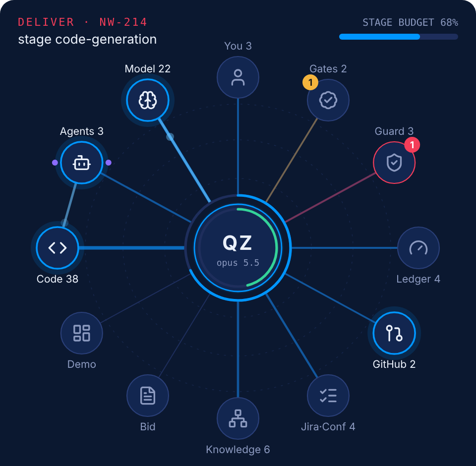

# QualiZeal console

A live map of the AI-DLC harness at work, in a pane beside the chat. Every tool call sends a pulse from the core
to its station and back; the guard's refusals turn red, anything waiting on you turns amber.

**Stations**: You · Gates (questions and the guard's asks, waiting for your yes) · Guard (blocks, by rule id) ·
Ledger (run, stage, report card, audit) · GitHub · Jira and Confluence · Knowledge (Knowledge Fabric, web) · Bid
(pricing, SOW, deck, voice check) · Demo (starters, check, bundle, record) · Code (files and shell) · Agents (sub-agents
circle it while they work) · Model (each step).

**Top line**: the lane, the story or bid key and the stage, as the harness announces them, with the stage's token
budget. **Core**: outer ring = stage budget (amber at 80%, red at 100%), inner ring = context window. **Under a
station**: how many points of the context window its calls added this session (`ctx +12%`). The growth between two
readings is shared equally among the calls that finished in between; with none, it is the model's own. It is a
share, not a measurement of each result. **Footer**: guard rules seen this session. **Feed** under the map: the
last 16 actions, repeats folded.

## Where it runs

Claude Code in a terminal (text only, at least 144 columns) and the **Code** tab of the Claude desktop app. It does
not run in the Claude chat app. The pane opens when a session starts; type `/qz-console` to open it again.

## Install

With the QualiZeal managed settings rolled out it is already on. Otherwise: `/plugin install qz-console@qualizeal`,
then restart the session. Options in `/plugin` → qz-console → Configure: colours (auto, dark, light), whether to show
guard rule names, and the name at the centre.

## What it does not do

It reads no files, makes no network requests, runs no processes, calls no model and adds nothing to the conversation.
Labels hold names only (a file's last two path parts, a tool, a rule id), never content or the guard's message.
It needs `qz-aidlc` 0.2.0 or later for the lane and stage line; without it the map still shows every call.

Tested with Claude Code's mod test runner (`hooks/qz-console.test.tsx`, 13 tests) on Claude Code 2.1.328.
